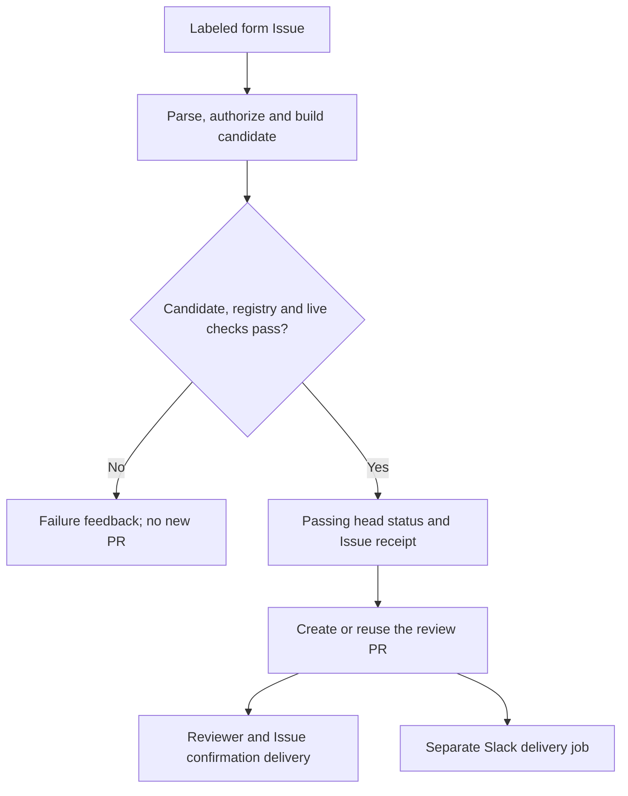
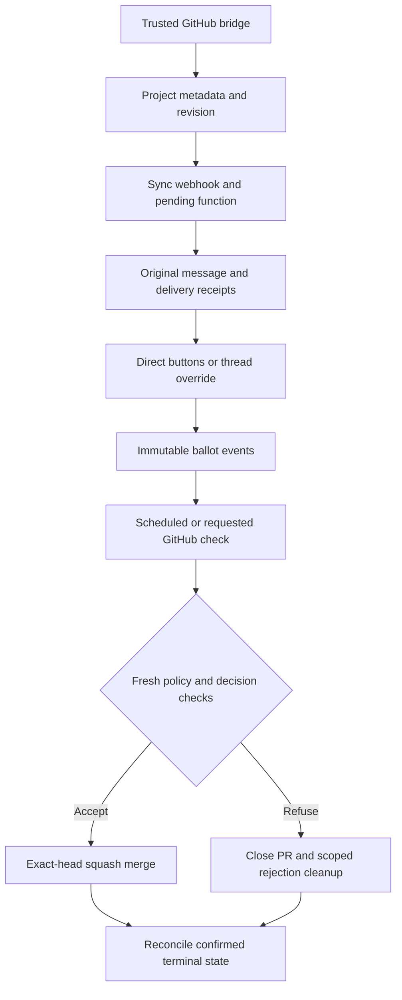

# Implementation and workflow architecture

This is the implementation reference for maintainers and LLMs. Start with
[AGENTS.md](../AGENTS.md); use [maintenance](MAINTENANCE.md) for recovery and test
selection. Workflow YAML and code define behavior; diagrams summarize it.

## Data and ownership

| Source / state | Owner and purpose |
| --- | --- |
| `config.yaml` | Schema, form wording, kind rules, reviewer routing and SC team |
| Root `working_groups/<CODE>.yaml` | Group definitions and deliverable IDs |
| Root `projects/<ID>.yaml` on main | Accepted project registry |
| Generated Issue forms / CODEOWNERS | Projections of config, catalogues and claim eligibility |
| Issue title/body | Visible summary plus compressed native form answers in a hidden HTML comment |
| `submission` / `claim` provenance | Issue binding, requester, time, hashes and applied command receipts |
| Reserved proposal branch | Exactly one proposed project-file change, not accepted state |
| GitHub memberships / PRs / comments / refs | Live authorization and freshness evidence |
| Slack datastores | Review metadata, immutable events and delivery receipts; not the accepted registry |

`schema_version` is currently 1. Internal project IDs match `P<digits>.yaml`; declarations
use their Issue number padded to six digits. Permanent display identifiers
(`SCM1`, etc.) are allocated only after acceptance and tracked atomically in
`projects/number_registry.yaml`. Projects belong to exactly one WG. A claim edits its existing CPP ID.
`submission.submitted_at` is the Issue creation time, not an acceptance date.
Claims retain original declaration provenance and add separate `claim` metadata.
There is no saved-answer database, correction form or state branch.
If a rendered Issue would exceed GitHub's body limit, intake preserves its
complete native form body instead of truncating it.

## Module map

| Component | Responsibility |
| --- | --- |
| `project_registry.py` | Strict YAML, local schema binding, catalogues, record validation, SC change policy and exports |
| `issue_form.py` | Generate/verify forms and stable field labels; submission bot identity |
| `submission.py` | Form decoding, optional cleanup, provenance, paths and shared candidate/bot snapshot validation |
| `issue_intake.py` | Live Issue processing, candidate commits, pre-publication policy, one-PR publication, feedback and scoped cleanup |
| `commands.py` | Parse commands as data; authorize, stage, replay and recover edits |
| `claims.py` | CPP eligibility, target fingerprint, allowed fields and live reservations |
| `review.py` | Safe Issue/PR rendering and idempotent reviewer synchronization |
| `validate_pr.py` | Repository API adapter, separate organization API adapter, exact-base independent PR checks and statuses |
| `generated_files.py` | Render and compare all four native forms and CODEOWNERS |
| `accepted.py` | Acceptance-only number allocation, ledger checks and atomic accepted-data writes |
| `updates.py` | Prefilled optional update form, live lead/SC checks, all-or-nothing writes and replay receipts |
| `wiki.py` | Accepted-project tables/pages, public issue snapshots, scoped wiki publication |
| `sync_generated.py` | Trusted-main generation on main or SC PRs, with scoped protected-main fallback |
| `dispatch.py` | Inline output handoff or explicit standalone policy dispatch |
| `setup/action.yml` | Python 3.12 and pinned dependency cache/install |
| `policy/action.yml` | Exact-base validation or prevalidated handoff; live-head Slack gating and dispatch receipt |
| `../slack/bridge.py` | Validate proposals, count SC, synchronize polls, freeze/apply decisions and reconcile GitHub results |
| `../slack/functions/` | Slack delivery, direct interactions and thread overrides |
| `../slack/logic.ts` / `blocks.ts` | Vote reduction and message/snapshot rendering |

The repository adapter scopes REST calls to its repository and refuses
redirects. The team adapter uses `SC_TEAM_READ_TOKEN` separately. Only immutable
Git trees and blobs are cached within a process. Mutable metadata and membership
are re-read for authorization/freshness checks.

## New submission and publication boundary

`issue_intake.process` verifies Issue state/labels, main, live roles, retained
source, existing branch scope and any command history. It builds the exact Git
candidate and calls `validate_submission_snapshot`, also used by independent
bot-PR validation. It validates the complete registry, rechecks freshness,
publishes `Project policy=success`, checks the local output handoff and writes
a checks-passed Issue receipt before PR creation.

Creation is the last required submission write. A preparation failure never
opens then rolls back a new PR. If the creation response is lost, intake searches
the uniquely reserved branch and verifies the observed PR head/base before
recognizing publication. Reviewer assignment, routing and final confirmation
failures after publication are retryable delivery warnings. They cannot enter
the invalid-submission cleanup handler.
Reviewer synchronization refreshes live assignments first. A 422 response is
treated as idempotent success only if another read confirms all requested
users/teams are already assigned; other failures remain visible for retry.

The branch is `project-submissions/issue-<number>`. A scoped submission commit
has one parent and message `Project submission <number>`. New declarations add
only their own project file; claims modify only their target. Main/ref/Issue
freshness and live permissions are rechecked around writes. Cleanup never
deletes an unrelated or unexpectedly advanced branch.

## Event routing

| Event | Route and rationale |
| --- | --- |
| Submission label applied | `projects.yml: submit`; forms apply one recognized label, so no duplicate `issues.opened` intake |
| Relevant Issue edit/reopen/unlabel/close | `submit`; ignore unrelated labels, verify live state, cancel only an actually closed proposal |
| New slash-command comment | `submit` → `commands.process`; ordinary comments do not run intake |
| Edited/deleted command comment | Check receipts; changing an applied command blocks policy |
| Bot proposal PR reopened / closed unmerged | `submit` repairs or performs rejection cleanup; stale/merged events are excluded |
| Other open/synchronized/reopened PR or base edit | `validate`; prose-only edits and closed PRs skip policy |
| Successful submission output | `notify` depends on `submit`; use its `pr_number` and true/false Slack routing without another policy pass |
| Update-form label | `projects.yml: update`; authorize the selected project, apply without review, dispatch maintenance |
| Main push / 00:17 UTC | `maintenance.yml`; allocate missing WG numbers, generate, reload main, export, check team access and publish wiki |
| Matching bot PR closed | `slack.yml: sync` reconciles message status |
| 00:00 UTC / manual Slack check / thread override | `slack.yml` validates current data and can apply decisions |

All three workflows use trusted code. Submission, policy, generation and Slack
decision jobs share `project-submission-and-policy`, `queue: max`,
`cancel-in-progress: false`. Maintenance has no PR event trigger; the project
workflow owns PR generation. Explicit manual operations are listed in the
[workflow guide](../.github/workflows/README.md).

`GITHUB_TOKEN` writes do not cause the usual follow-on workflow events. Intake
therefore exports its result to `notify`; independent policy queues Slack
explicitly. Generated-file PRs and standalone callers dispatch policy when
needed. After an Actions-bot merge, the bridge dispatches maintenance explicitly;
a human merge already causes a main push run.

## Independent PR policy and generation

PR checks first run generation from trusted current main. Policy then resolves
the live PR base and executes from that exact accepted base SHA, never the
proposed head. It validates the repository/main binding, actual author and
head/base freshness. A bot proposal reconstructs its data from its Issue and
live comment history. A human PR requires an active SC author. The special
`project-config/generated` bot branch can contain only currently required
generated outputs, validated against accepted configuration.

On an SC PR, generation reads proposed config/catalogue/records as data and
appends generated changes to the observed head without force-pushing. On main,
it attempts a non-forced commit. A recognized protection rejection opens or
refreshes the one reserved generation PR. Only generated paths may be written.
Main maintenance refreshes pending claim checks and exports both catalogues.

Unit tests are optional local checks; required status **Project policy** is
runtime data/permission validation, not the unit-test suite. A green
`PIT Slack sync queued` status records dispatch only, not successful delivery.

## Commands and claims

Command syntax/help live together in `commands.SPECS`. Input is parsed into
operations; nothing is sent to a shell. Live author identity and role checks
apply before each edit. Only description replacement is multiline. Initial
optional cleanup may drop malformed optional values; command edits reject
invalid supplied values atomically at validation.

Each applied command stores comment ID, numeric author ID and body hash.
`current_record` rebuilds the record from the retained form and live comments,
checking permission at that point in lead history and current organization
membership. A forged YAML receipt or edited/deleted comment cannot authorize an
edit. Authorized intermediate summaries support interrupted synchronization;
the final independent check still requires the final reconstructed summary.

A staged command updates the existing branch with a pending status, then
synchronizes Issue/PR data and runs the shared candidate policy. Brief failures
retry without another receipt. Unfinished synchronization stays blocked and
can be recovered with `submit` on the same Issue. Commands cannot edit accepted
records. CPP declarations prohibit people/PhD commands; claims prohibit changes
to title, description, groups, deliverables and PhD fields.

Claims require an accepted open CPP without leads or prior claim (legacy active unassigned CPPs remain supported). The target
fingerprint prevents overwriting SC changes during review; live reservation
checks allow only one open claim per target. The permitted delta is people,
Slack, repository, links, claim provenance and the transition to active status. Rejection releases a pending
reservation; accepted claim provenance prevents implicit reassignment later.

## Slack data flow

Only EP and CPP-claim PRs are eligible. The bridge validates current main and the
exact proposed record, including command replay, before poll synchronization
and again before applying a decision. It reuses intake to refresh stale bot
branches. Changed scientific/project information starts a fresh revision and
resets votes/overrides; unchanged information keeps its revision even if the
commit head or provenance changes. Restoring older content still gets a new
revision rather than reviving its old votes.

| Slack datastore | Writer / contents |
| --- | --- |
| `pit_projects` | GitHub bridge; serialized project metadata, revision, quorum and decision state |
| `pit_ballots` | Slack functions; immutable interaction/override events, one latest vote per actor when reduced |
| `pit_messages` | Slack functions; root/revision locations, interaction ownership and delivery acknowledgements |

Direct buttons belong to the original sync function execution, kept pending for
the review lifetime. That expected pending execution avoids starting a workflow
on every click. A terminal synchronization removes buttons and attempts to
complete it. `triggers/vote.ts` and the vote workflow support older polls only.

Delivery reserves a receipt before posting. A lost response must be reconciled
with the actual message timestamp rather than automatically reposted. A webhook
HTTP 200 only acknowledges invocation; the bridge waits for `ack:<delivery>`.
The initial information revision is already represented by the root, so no
initial duplicate thread snapshot is posted. Later changed revisions post their
snapshot in the same thread. Preserve receipts during recovery.

SC count comes from the configured live GitHub team, including maintainers,
with pagination and case-insensitive deduplication. Quorum is `floor(N/2)+1`
participants. Abstentions count toward participation; Accept versus Refuse
majority decides after quorum. Ties stay waiting. There is no GitHub/Slack voter
identity mapping: the private, unshared channel's membership is the voter trust
boundary. Excess distinct voters block a decision.

Ordinary clicks update events/tallies without dispatching GitHub. Exact commands
`!force-accept` / `!force-refuse` in the original thread store overrides and
dispatch a check using the app's Actions-write token. At decision time a cutoff,
revision and SC count are frozen. A blocked decision can retry; a newer valid
override can replace it. GitHub state confirms acceptance/refusal, including
recovery when an API response is lost. `sync` is not a dry run: it can resume
frozen work or pending overrides as well as reconciling terminal state.

## Trust boundaries and extension points

Repository writes use scoped Actions credentials. Membership reads use a
separate token. Slack receives an Actions-write dispatch credential, not a
repository contents/merge credential; GitHub's trusted bridge performs merges.
Slack CLI service credentials and the sync webhook remain in Actions secrets.
See the [credential inventory](../slack/INSTALLATION.md#credentials-and-settings).

Fail closed on unavailable membership, mismatched repository/channel, unexpected
paths/modes/history, changed Issue/head/base or missing provenance. Do not treat
labels, a requested reviewer, displayed Slack counts or a stale green status as
authorization. Required repository reviews and protection still apply.

To extend a field, update config/schema, generation/parsing, record policy,
rendering, command support/replay and relevant tests. To add a workflow path,
update event routing, permission declarations and duplicate-dispatch checks.
To change voting, keep Python and TypeScript reductions aligned through shared
`slack/tests/cases.json`. Keep data directories free of Markdown.

## Accepted project updates and wiki

The complete data flow, schema, permissions, refresh behavior and installation
requirements are in [WIKI.md](WIKI.md). The main maintenance job first allocates
permanent WG numbers from accepted main, then regenerates forms/exports and wiki.
Allocation and update transactions validate the entire resulting registry,
recheck live main, and append a non-forced commit. Existing IDs never move.

Update requests are bound to an authenticated live Issue author and a current
accepted project number. The URL prefill is convenience, never authorization.
A current lead or live SC member can apply optional fields without a review PR.
One invalid field refuses the entire transaction. Audit receipts prevent replay
of applied requests, including after a lost API response. Blank/identical input
makes no project write. The update job shares the submission/policy queue and
explicitly dispatches maintenance after applying/reconciling a change.

Generated wiki content never executes requester code or embeds live frames.
Only public repository issue titles are mirrored, because writer access is not
proof of reader access. Private repositories remain links. Generated pages are
tracked by a scoped manifest; unrelated wiki pages survive refreshes. Wiki Git
publishing receives its own credential only in the publication step.
